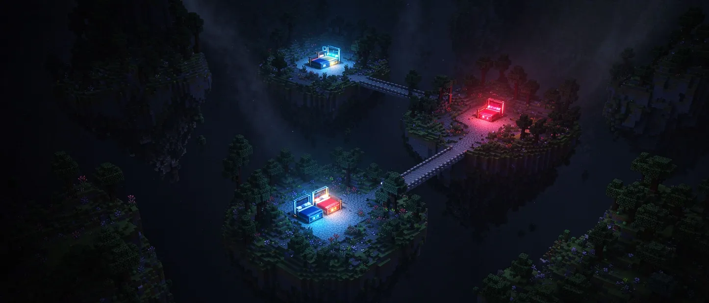

  
  <h1>MatchCore Portal</h1>
  
<strong>Competitive Minecraft, with every point accounted for.</strong>

  
<a href="./README.zh-CN.md">简体中文</a>

MatchCore is a competitive Bedwars platform built around focused 1v1 and 2v2 matches, weighted Elo ratings, and a clear record of every result.

This repository powers [mcnb.dev](https://mcnb.dev/), the bilingual home for MatchCore Arena and the HA ecosystem.

## Why MatchCore

- **Built for competition.** Step into ranked Bedwars with a rating that reflects every completed match.
- **Your results stay visible.** Career history, rankings, and score changes give progress a lasting record.
- **One identity across the ecosystem.** HRPAuth connects players, services, and their Minecraft experience.

## Explore

- [MatchCore Arena](https://mcnb.dev/) — the competitive experience
- [HRPAuth](https://auth.mcnb.dev/) — accounts and ecosystem services
- [HA Wiki](https://wiki.mcnb.dev/) — deployment and development documentation
- [Arena Client](https://github.com/CoreMatch/MatchCoreArena-Client) — desktop client source

## About this site

The portal pairs English and Chinese pages with original MatchCore artwork, responsive layouts, and a live Arena status check with a clearly labeled fallback. MatchCore client builds are distributed from source; no prebuilt installer is currently offered.

## License

[AGPL-3.0](LICENSE)
