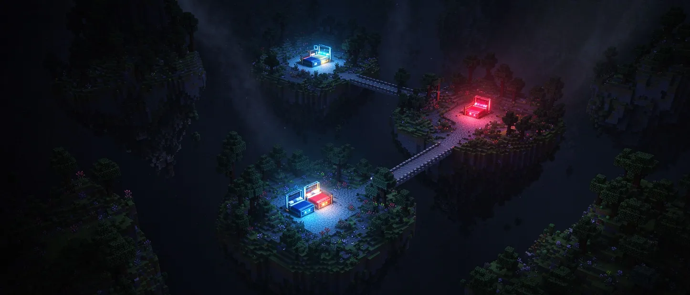

  
  <h1>MatchCore Portal</h1>
  
<strong>每一场竞技，都有迹可循。</strong>

  
<a href="./README.md">English</a>

MatchCore 是一个围绕 1v1、2v2 Bedwars 对局打造的竞技平台，以加权 Elo 评分记录实力，也让每一场比赛的结果都有据可查。

本仓库驱动双语官网 [mcnb.dev](https://mcnb.dev/)，呈现 MatchCore Arena 与 HA 生态。

## 为什么是 MatchCore

- **为竞技而生。** 进入排名对局，让评分真实反映每一场完成比赛的积累。
- **成长清晰可见。** 生涯战绩、排行榜与分数变化，让每一步进步都有记录。
- **一个账号，连接整个生态。** HRPAuth 将玩家、服务与 Minecraft 体验连接在一起。

## 进一步了解

- [MatchCore Arena](https://mcnb.dev/) — 竞技体验
- [HRPAuth](https://auth.mcnb.dev/) — 账号与生态服务
- [HA Wiki](https://wiki.mcnb.dev/) — 部署与开发文档
- [Arena 客户端](https://github.com/CoreMatch/MatchCoreArena-Client) — 桌面客户端源码

## 关于本站

官网提供中英双语页面、MatchCore 原创视觉、响应式布局，以及带有明确降级提示的 Arena 实时状态检查。MatchCore 客户端目前通过源码分发，暂未提供预编译安装包。

## 许可证

[AGPL-3.0](LICENSE)
